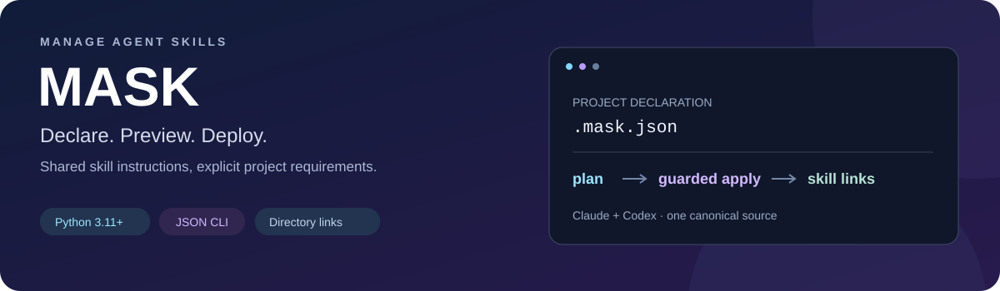

**[Install](#install-and-select-a-source) · [First project](#add-skills-to-a-project) · [Updates](#update-skills-or-the-program) · [Recovery](#recover-or-stop-managing-a-project) · [CLI reference](docs/architecture/cli-contract.md)**

MASK keeps project skill requirements in Git and deploys them as directory symlinks to one local skill checkout. A project declares what it needs in `.mask.json`; MASK validates the source, previews changes, and manages the links used by Claude and Codex.

This repository contains the Python CLI. The companion [AgentSkills repository](https://github.com/MikeMarcin/AgentSkills) contains the canonical skill instructions. Both repositories remain private.

## Requirements

- Python 3.11+ and Git. The runtime uses the Python standard library; there is no pip installation.
- Local checkouts of ManageAgentSkills and AgentSkills. Cloning and remote updates use your existing Git access.
- Directory symlink support. Windows needs existing symlink privileges; MASK does not elevate or substitute junctions or copies.

> [!NOTE]
> Native macOS and Windows checks passed with Python 3.14.7. Linux is best-effort. See the [readiness report](docs/releases/v0.1.0.md) for exact results and limitations.

## Install and select a source

Clone both repositories into a directory of your choice:

```sh
git clone https://github.com/MikeMarcin/ManageAgentSkills.git
git clone https://github.com/MikeMarcin/AgentSkills.git
```

On macOS or Linux, run the following from their parent directory using a supported `python3`:

```sh
mask_program="$PWD/ManageAgentSkills/mask.py"
skill_source="$PWD/AgentSkills"
mkdir -p "$HOME/.local/bin"
python3 "$mask_program" self install --bin-dir "$HOME/.local/bin" --json
"$HOME/.local/bin/mask" init --source "$skill_source" --json
"$HOME/.local/bin/mask" capabilities --json
"$HOME/.local/bin/mask" skill list --json
```

MASK writes a launcher that records the selected interpreter and program checkout. It leaves PATH unchanged. Use the absolute launcher path immediately, or add its directory to PATH yourself before using the shorter `mask` commands below. An unrelated or edited existing launcher is preserved and causes a refusal.

On Windows, use PowerShell with a known supported Python installation. For example, if Python 3.14 is installed and the repositories are under `C:\work`:

```powershell
$maskBin = Join-Path $env:LOCALAPPDATA 'Programs\MASK'
New-Item -ItemType Directory -Force -Path $maskBin | Out-Null
py -3.14 'C:\work\ManageAgentSkills\mask.py' self install --bin-dir $maskBin --json
& "$maskBin\mask.cmd" init --source 'C:\work\AgentSkills' --json
& "$maskBin\mask.cmd" capabilities --json
```

The direct entrypoint remains available if the launcher is missing: `python3 /absolute/path/to/ManageAgentSkills/mask.py ...` (or the corresponding supported Windows interpreter). `self status --json` reports the program, interpreter and launcher discovery. Installing the launcher and selecting the skill source are separate operations.

## Add skills to a project

Use an existing project root. These examples use `/absolute/path/to/project` as a placeholder; replace it before running them. `project init` creates an empty declaration, while `project register` records the project on this machine.

```sh
mask project init --project /absolute/path/to/project --json
mask project register /absolute/path/to/project --json
mask project require manage-agent-skills --project /absolute/path/to/project --apply --dry-run --json
```

Inspect the proposed actions and `data.plan_hash`. Apply that same proposal using its returned hash, then check the result:

```sh
mask project require manage-agent-skills --project /absolute/path/to/project --apply --expect-plan-hash RETURNED_HASH --json
mask plan --project /absolute/path/to/project --json
mask doctor --project /absolute/path/to/project --check --json
```

> [!TIP]
> A converged plan reports `would_change: false`. If the hash is stale, review a new preview. Preserve collisions rather than deleting existing skill content.

Deploying `implement-rfc` also requires [consumer workflow context](https://github.com/MikeMarcin/AgentSkills#configure-implement-rfc).

| Intent | Command |
|---|---|
| Add requirements without removing others | `project require ID ...` |
| Remove selected requirements | `project unrequire ID ...` |
| Replace the complete membership | `project set --skill ID --skill OTHER` |
| Explicitly empty membership | `project set --clear` |
| Choose agent targets | `project set-targets claude codex` |
| Restore default targets | `project set-targets --inherit` |
| Inspect declaration and deployment | `project show --project PATH` |
| Reconcile existing declarations | `plan --project PATH`, then guarded `apply --project PATH` |

Membership edits change the manifest. Add `--apply` to reconcile a registered project in the same operation; add `--dry-run` to preview it first. Use `--json` for structured results throughout.

## What belongs where

A portable declaration contains skill IDs and optional targets:

```json
{
  "schema_version": 1,
  "skills": ["manage-agent-skills"],
  "targets": ["claude", "codex"]
}
```

| Location | Purpose |
|---|---|
| `AgentSkills/skills/<id>/` | Canonical skill payload, including `SKILL.md` |
| `<project>/.mask.json` | Versioned project requirements |
| `<project>/.mask/skill-config/implement-rfc/` | Versioned workflow context for that consumer |
| `<project>/.agents/skills/<id>` | Generated Codex directory symlink |
| `<project>/.claude/skills/<id>` | Generated Claude directory symlink |
| `~/.mask/` | Local machine configuration, ownership and recovery state |

Commit declarations and project context. Ignore generated links and `.mask/generated/`; prefer per-entry ignore rules when unrelated real skills share the directory. `--home PATH` overrides `MASK_HOME`, which otherwise defaults to `~/.mask`. Normal operation never requires editing internal state files.

## Update skills or the program

> [!IMPORTANT]
> A source update affects **every registered project**. Run it between active tasks; all links share one checkout, and running agents may cache instructions.

```sh
mask source status --json
mask source fetch --json
mask update --dry-run --json
mask update --expect-plan-hash RETURNED_HASH --json
```

`source fetch` refreshes Git objects and remote-tracking refs without activating content. The dry run performs no fetch and reports last-fetched state. `update` validates a frozen candidate against live project declarations, fast-forwards the source, and reconciles its consumers. Dirty, ahead, diverged, detached, unavailable or colliding inputs refuse instead of triggering a reset, stash, clean or push.

`mask self update --json` updates only the running ManageAgentSkills checkout. It checks protocol/schema compatibility and returns `next_invocation_required`; the next command loads the new implementation. It does not update skills or reinstall the launcher. Local skill management remains available while the program checkout has authoring changes.

## Recover or stop managing a project

Inspect an interrupted operation with `mask recover --inspect --json`. After checking the recorded intent, choose explicit `--complete` or `--rollback`. Recovery preserves unexpected edits and never resets a Git checkout that has advanced. Git helpers and checkout filters remain trusted subprocesses; MASK is not a sandbox or an atomic deployment system.

`mask project unregister PATH --json` removes only unchanged owned links and preserves the declaration, context and source. `--keep-links` explicitly abandons ownership, including for an unavailable project. Exact existing declared links can be adopted with `link adopt`; consult the [CLI contract](docs/architecture/cli-contract.md) for its required preconditions.

To remove the program, unregister the selected projects first, then explicitly remove the verified owned launcher and program checkout while preserving source history and backups. There is no purge command. Source relocation likewise requires an explicit unregister/setup/register sequence; a new `--home PATH` can preserve the old machine state during setup.

## Development and reference

For a local CLI smoke scenario, run `python3 -B -m unittest tests.test_end_to_end.EndToEndTests.test_public_management_sequence` from this checkout. It uses disposable projects and local bare Git remotes. Run `python3 -B scripts/verify_documentation.py` for the RFC/issue structure gate; choose additional tests for the behavior being changed.

- [CLI contract and exit codes](docs/architecture/cli-contract.md)
- [JSON schemas](schemas/)
- [Contributing](CONTRIBUTING.md), [RFCs](docs/rfcs/README.md) and [issue board](docs/issues/README.md)
- [Local v0.1.0 readiness and implementation provenance](docs/releases/v0.1.0.md)

Both named repositories currently consume the shared skills. Verified bootstrap copies remain outside discovery roots in each `.mask/bootstrap-retired/implement-rfc-2026-09-05`. Filesystem deployment and bounded workflow invocation were verified; agent UI loading was not. MASK has no daemon, automatic synchronization, global skill installation or publishing command.
